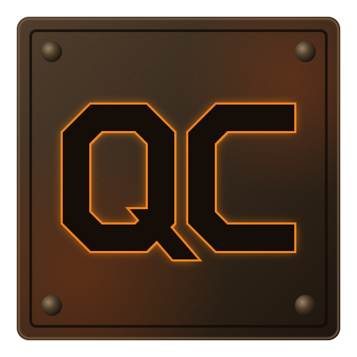

  

<h1 align="center">QuakeC Studio</h1>

  A modern IDE for QuakeC, the scripting language of id Software's <em>Quake</em>. 
  Edit, compile and launch your mod from one window.

<a href="https://www.quakecstudio.com">www.quakecstudio.com</a>

| Repository | What it is |
| --- | --- |
| [editor](https://github.com/quakecstudio/editor) | The QuakeC Studio editor |
| [site](https://github.com/quakecstudio/site) | The www.quakecstudio.com website |
| [infra](https://github.com/quakecstudio/infra) | AWS and GitHub infrastructure, in Terraform |

Quake is a trademark of id Software. QuakeC Studio is an independent project, not affiliated with or endorsed by id Software, ZeniMax or Microsoft.
